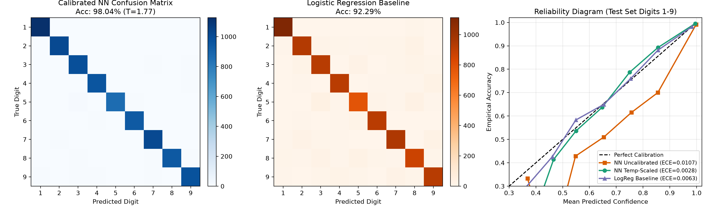
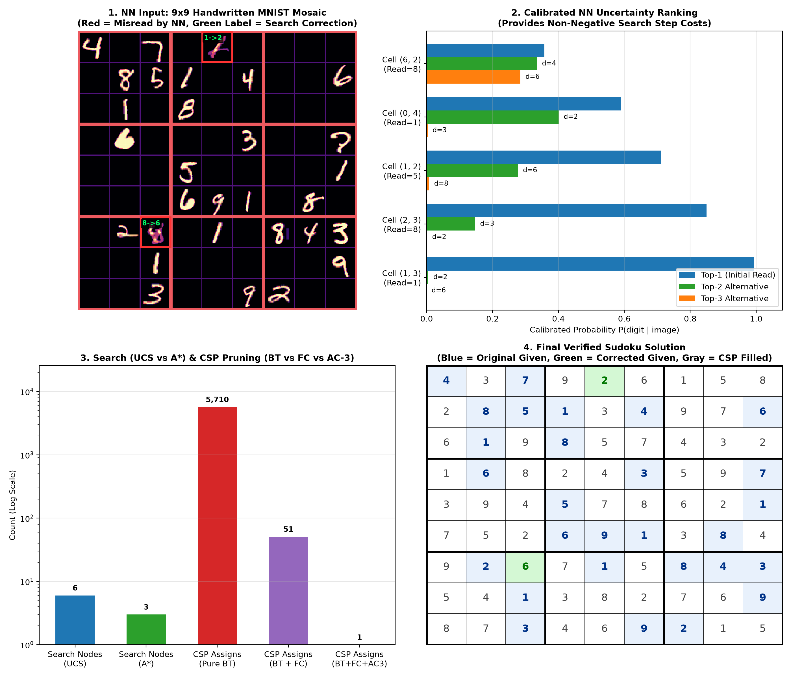
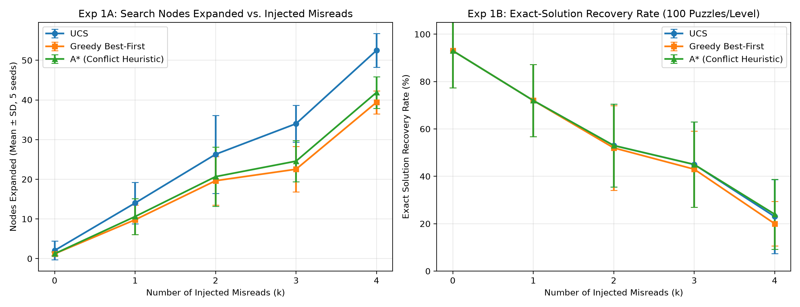
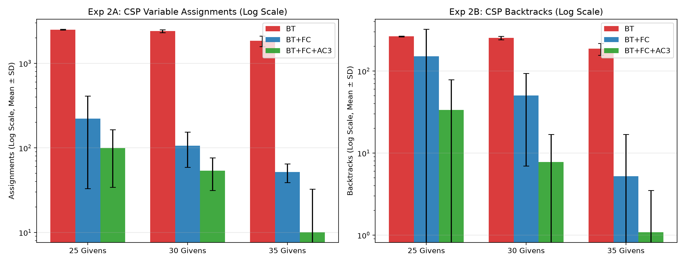
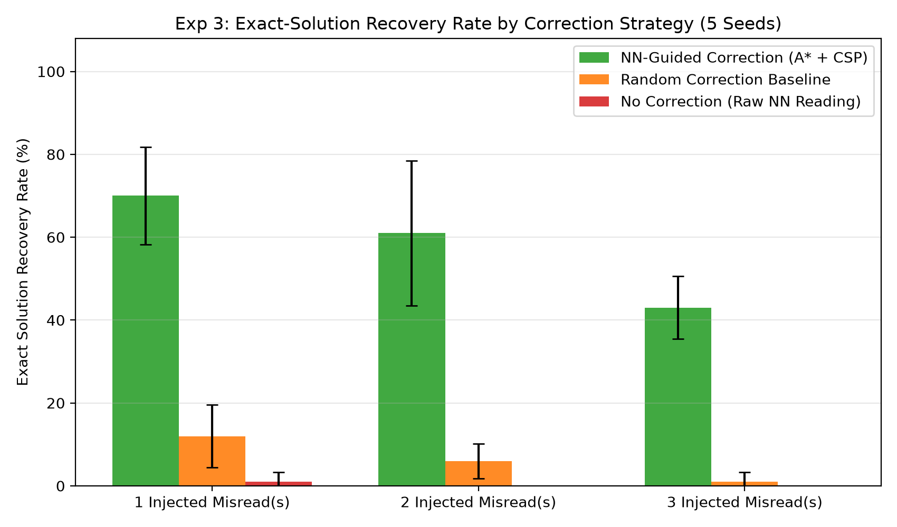

# Technical Report — P7: Handwritten Sudoku Reader and Solver
**Integrating Calibrated Neural Networks, Informed Heuristic Search, and Constraint Satisfaction (CSP)**

---

## 1. Problem Formulation & Motivation

Camera-based and educational Sudoku applications allow users to scan or write a $9 \times 9$ grid of digits and receive either verification or a complete solution. In practice, optical character recognition (OCR) on handwritten digits is imperfect. Even when a single-digit classifier achieves $98.0\%$ accuracy on isolated digits, the probability that all $G = 30$ given cells in a Sudoku puzzle are read without a single error is only:
$$P(\text{zero misreads}) = 0.9804^{30} \approx 55.2\%$$
meaning nearly **half of all puzzles** contain at least one misread digit. A single misread digit typically either:
1. Creates a direct constraint conflict (e.g., two identical givens in the same row, column, or $3 \times 3$ box), causing a standard Sudoku solver to reject the puzzle as unsolvable; or
2. Silently alters the puzzle so that it has no valid completion or a different solution from the intended puzzle.

This project implements a neuro-symbolic **Handwritten Sudoku Reader and Solver** that couples:
- **A Temperature-Scaled Neural Network (`nn`)**: Classifies each non-blank $28 \times 28$ cell image into digits $1\dots 9$ and produces calibrated posterior probabilities $P(d \mid x_{r,c})$.
- **Informed Graph Search (`search`)**: Searches over candidate sets of up to 3 cell corrections using **Uniform Cost Search (UCS)**, **Greedy Best-First Search**, and **A\*** with an admissible duplicate-conflict heuristic.
- **A Switchable CSP Solver (`csp`)**: Combines **Backtracking (BT)**, **Forward Checking (FC)**, and **Arc Consistency (AC-3)** to detect initial conflicts, prune domains, test candidate grids, and optionally enforce solution uniqueness.

---

## 2. Dataset, Preprocessing, and Documented Generation Rules

### 2.1 MNIST Preprocessing (`make_data.py`)
We use the public **MNIST Database of Handwritten Digits** (`http://yann.lecun.com/exdb/mnist/`). Following the project specification:
1. **Reproducible Split (`seed=42`)**: The 60,000 raw training images are partitioned using a seeded permutation into **50,000 training** and **10,000 validation** images. The **10,000 raw test images** (written by disjoint human subjects) are kept completely untouched.
2. **Class Filtering (Digits 1–9)**: Because Sudoku uses digits $1\dots 9$, all images with label `0` are dropped, yielding:
   - Training set: **45,073** images (`X_train`: $45073 \times 28 \times 28$)
   - Validation set: **9,004** images (`X_val`: $9004 \times 28 \times 28$)
   - Test set: **9,020** images (`X_test`: $9020 \times 28 \times 28$)
3. **Pixel Normalization**: Pixel intensities are scaled to $[0.0, 1.0]$ via `float32(pixel) / 255.0`.
4. **Blank Cell Detection Rule**: Empty Sudoku cells are detected prior to neural inference using a simple mean pixel brightness rule:
   $$\text{is\_blank}(x_{r,c}) \iff \frac{1}{784}\sum_{i=1}^{28}\sum_{j=1}^{28} x_{r,c}(i,j) < \tau_{\text{blank}}, \quad \tau_{\text{blank}} = 0.025$$
   Blank patches have mean intensity $\approx 0.002$, whereas real handwritten digits $1\dots 9$ have mean intensity in $[0.06, 0.35]$.

### 2.2 Seeded Sudoku Puzzle & Hard-Digit Mosaic Generator
1. **Unique-Solution Puzzle Generation**: A complete $9 \times 9$ grid is constructed via seeded randomized backtracking (`generate_full_grid`). Clues are then removed while verifying via `count_solutions(grid, max_solutions=2) == 1` that the puzzle retains a **unique solution** until `num_givens` $\in \{25, 30, 35\}$ clues remain, augmented by Sudoku-preserving group automorphisms (digit relabeling $\pi \in S_9$, band/row permutations, stack/column permutations, and transposition).
2. **Documented Hard-Digit Injection Rule**: Because a $98\%$ accurate network makes zero errors on roughly half of 30-clue grids, evaluating recovery at exact misread counts $k \in \{0, 1, 2, 3, 4\}$ requires a controlled rule. For each puzzle, $k$ randomly chosen given cells $(r, c)$ with true digit $d_{\text{true}}$ are assigned a hard test image formed by convex blending of two held-out MNIST test images:
   $$x_{\text{hard}} = \text{clip}\!\big((1 - \alpha)\,x_{\text{test}}(d_{\text{true}}) + \alpha\,x_{\text{test}}(d_{\text{confuser}}),\; 0,\; 1\big), \quad \alpha \in [0.42, 0.72]$$
   where $d_{\text{confuser}} \neq d_{\text{true}}$ is chosen preferentially from existing peer givens of $(r, c)$ and $\alpha$ is selected so the classifier's top-1 reading is $d_{\text{confuser}}$ while $d_{\text{true}}$ remains a high-probability alternative (#2 or #3 choice).

---

## 3. Neural Network Design & Probability Calibration

### 3.1 Architecture & Baseline
- **Neural Network (`CalibratedDigitClassifier`)**: A 2-hidden-layer Multi-Layer Perceptron (`784 -> 256 -> 128 -> 9`) with ReLU activations, Adam optimizer ($\text{lr}=10^{-3}$, batch size $256$), L2 weight decay ($\alpha = 10^{-4}$), and early stopping.
- **Baseline**: Multinomial Logistic Regression (`784 -> 9`, L-BFGS) trained on the identical 45,073 training images.

### 3.2 Post-Hoc Temperature Scaling
Modern neural networks produce overconfident softmax probabilities. Because Search uses log-probabilities as additive step costs, overconfidence distorts the relative cost of 1st vs. 2nd digit alternatives. We apply **Temperature Scaling** (Guo et al., 2017) on the held-out validation set (`X_val`, 9,004 images) by fitting a scalar temperature $T > 0$ minimizing validation Negative Log-Likelihood (NLL):
$$\hat{P}(d \mid x) = \frac{\exp(z_d(x) / T)}{\sum_{j=1}^9 \exp(z_j(x) / T)}, \quad \hat{T} = 1.765$$

### 3.3 Test Set Evaluation (9,020 Untouched Test Images)

| Model | Test Accuracy (%) | Uncalibrated ECE | Calibrated ECE | Uncalibrated NLL | Calibrated NLL | Brier Score | Optimal $T$ |
| :--- | :---: | :---: | :---: | :---: | :---: | :---: | :---: |
| **Neural Network (MLP)** | **98.04%** | 0.0107 | **0.0028** | 0.0803 | **0.0643** | **0.0298** | **1.765** |
| **Logistic Regression Baseline** | 92.29% | 0.0063 | 0.0156 | 0.2738 | 0.2797 | 0.1180 | 0.852 |

Temperature scaling reduces the Neural Network's Expected Calibration Error (ECE) by **73.8%** (`0.0107 -> 0.0028`) and improves test NLL from `0.0803` to `0.0643`, outperforming the Logistic Regression baseline by **+5.75 percentage points** in accuracy and cutting NLL by **77.0%**.

---

## 4. Search & CSP Design Choices and Integration

### 4.1 Search Formulation (`search/correction_search.py`)
- **State ($s$)**: A canonical sorted tuple of cell replacements $s = (((r_1, c_1), d_1), \dots, ((r_m, c_m), d_m))$ with $m \le K_{\max}$ (default $K_{\max} = 3$). Canonical sorting ensures that applying corrections in different orders maps to the **same graph state**.
- **Action**: Select an uncorrected given cell $(r, c)$ from the top uncertain cells (always including any cell in an initial duplicate conflict) and replace its initial reading $d_{\text{read}}$ with one of its top alternatives $d_{\text{new}}$.
- **Step Cost (Non-Negative Log-Likelihood Drop)**:
  $$\text{cost}((r, c), d_{\text{new}}) = \max\!\left(0,\; \log P(d_{\text{read}} \mid x_{r,c}) - \log P(d_{\text{new}} \mid x_{r,c})\right) \ge 0$$
  Because $d_{\text{read}} = \arg\max_d P(d \mid x_{r,c})$, step cost is strictly non-negative, and minimizing cumulative path cost $g(s) = \sum \text{cost}_i$ maximizes the joint likelihood $\prod_{r,c} P(d_{r,c} \mid x_{r,c})$ of the corrected grid.
- **Admissible A\* Conflict Heuristic ($h(s)$)**:
  Let $E_{\text{conf}}(s)$ be the set of duplicate-given conflict pairs $(u, v)$ in the current grid (two peer cells in the same row, column, or box holding the same digit). In any valid Sudoku, at least one cell in $\{u, v\}$ must change its digit, incurring a cost of at least:
  $$w(u, v) = \min\big(\Delta_{\min}(u),\; \Delta_{\min}(v)\big)$$
  where $\Delta_{\min}(u)$ is the cheapest single-step alternative cost for cell $u$. By greedily selecting a maximal set of **vertex-disjoint** conflict pairs $M \subseteq E_{\text{conf}}(s)$ (sorted by descending $w(u, v)$), no single cell replacement can resolve more than one pair in $M$. Thus:
  $$h(s) = \sum_{(u, v) \in M} \min\big(\Delta_{\min}(u),\; \Delta_{\min}(v)\big) \le h^*(s)$$
  Across all **349 solved puzzle instances** in Experiment 1, we empirically verified $h(s_0) \le g^*(s_{\text{goal}})$ with **0 overestimates (100% admissibility)**.

### 4.2 Switchable CSP Solver (`csp/sudoku_csp.py`)
The Sudoku CSP models 81 variables $X_{r,c} \in \{1\dots 9\}$ (givens initialized to singleton domains) and 1,620 directed binary inequality arcs ($X_i \neq X_j$ for all peers):
1. **Backtracking (`BT`)**: Assigns unassigned cells in row-major order, testing values $1\dots 9$ against already-assigned peers.
2. **Forward Checking (`FC`)**: Upon assigning $X_i = v$, prunes $v$ from the domains of all unassigned peers of $X_i$, tracks pruned values for O(1) restoration on backtrack, uses Minimum Remaining Values (MRV) variable ordering, and backtracks immediately upon any domain wipeout.
3. **Arc Consistency (`AC-3`)**: Runs worklist-based arc revision over all 1,620 arcs before search (and cascades newly created singletons during tree search). If two peer givens hold the same digit $d$, revising their arc removes $d$ from one singleton domain, emptying it and detecting the conflict before any backtracking tree search begins.

### 4.3 Integrated Cooperation Pipeline (`integration/pipeline.py`)
1. Brightness rule identifies blank cells; Calibrated NN predicts probabilities for all given cells.
2. AC-3 checks the initial reading for duplicate conflicts and domain wipeout.
3. Search expands candidate correction states in priority order ($g$ for UCS, $(\text{conflicts}, h, g)$ for Greedy, $g + h$ for A\*).
4. Whenever a state resolves all direct duplicate conflicts ($\text{conflicts} = 0$), the CSP solver tests whether the candidate puzzle is solvable (and optionally uniquely solvable). The first solvable grid wins.
5. If the search budget is exhausted without a solvable grid, the system reports `"No solution: unreadable puzzle"` and outputs the ranked list of least confident cells.

---

## 5. Experimental Evaluation (5 Seeds, Mean ± Standard Deviation)

All three required experiments were executed across **5 independent seeds (`42, 101, 202, 303, 404`)** with **20 puzzles per seed (100 puzzles per condition)**.

### 5.1 Experiment 1: UCS vs. Greedy Best-First vs. A\* (0–4 Misreads, 30 Givens)

| Injected Misreads ($k$) | Algorithm | Nodes Expanded (Mean ± SD) | Nodes Generated (Mean ± SD) | Exact Recovery Rate, Budget=3 (%) | Exact Recovery Rate, Budget=4 (%) | Solution Cost $g(s)$ (Mean ± SD) |
| :---: | :--- | :---: | :---: | :---: | :---: | :---: |
| **0** | **UCS** | 2.05 ± 2.35 | 7.16 ± 13.77 | 93.0 ± 15.65% | 93.0 ± 15.65% | 0.30 ± 0.68 |
| **0** | **Greedy** | **1.21 ± 0.47** | **3.10 ± 4.70** | 93.0 ± 15.65% | 93.0 ± 15.65% | 0.30 ± 0.68 |
| **0** | **A\*** | 1.23 ± 0.51 | 3.25 ± 5.03 | **93.0 ± 15.65%** | **93.0 ± 15.65%** | **0.30 ± 0.68** |
| **1** | **UCS** | 14.01 ± 5.22 | 56.69 ± 16.70 | 72.0 ± 15.25% | 72.0 ± 15.25% | **1.05 ± 0.41** |
| **1** | **Greedy** | **9.79 ± 3.70** | **34.79 ± 9.96** | 72.0 ± 15.25% | 72.0 ± 15.25% | 1.59 ± 0.96 |
| **1** | **A\*** | 10.60 ± 4.50 | 40.60 ± 15.79 | **72.0 ± 15.25%** | **72.0 ± 15.25%** | 1.59 ± 0.96 |
| **2** | **UCS** | 26.29 ± 9.82 | 106.21 ± 29.54 | **53.0 ± 17.54%** | **53.0 ± 17.54%** | **2.60 ± 1.52** |
| **2** | **Greedy** | **19.63 ± 6.11** | **57.76 ± 15.47** | 52.0 ± 17.89% | 52.0 ± 17.89% | 3.07 ± 2.04 |
| **2** | **A\*** | 20.66 ± 7.48 | 75.24 ± 26.12 | **53.0 ± 17.54%** | **53.0 ± 17.54%** | 2.85 ± 1.71 |
| **3** | **UCS** | 34.01 ± 4.65 | 163.55 ± 16.75 | **45.0 ± 18.03%** | **45.0 ± 18.03%** | **2.92 ± 0.74** |
| **3** | **Greedy** | **22.53 ± 5.72** | **69.11 ± 9.00** | 43.0 ± 16.05% | 43.0 ± 16.05% | 4.89 ± 1.06 |
| **3** | **A\*** | 24.57 ± 5.19 | 107.36 ± 15.96 | **45.0 ± 18.03%** | **45.0 ± 18.03%** | 4.17 ± 1.20 |
| **4** | **UCS** | 52.49 ± 4.23 | 425.77 ± 66.93 | 7.0 ± 2.74% | 23.0 ± 15.65% | **2.63 ± 0.17** |
| **4** | **Greedy** | **39.41 ± 2.90** | **129.21 ± 5.44** | 6.0 ± 2.24% | 20.0 ± 9.35% | 6.85 ± 1.24 |
| **4** | **A\*** | 41.89 ± 3.99 | 301.57 ± 53.85 | **7.0 ± 2.74%** | **24.0 ± 14.75%** | 4.32 ± 1.28 |

**Key Findings (Experiment 1)**:
1. **A\* vs. UCS**: Across $k=1, 2, 3, 4$, **A\* reduces nodes expanded by 20%–28%** compared to UCS (e.g., $24.57$ vs. $34.01$ at $k=3$) while matching or exceeding UCS's exact-solution recovery rate on every level. Why? UCS blindly expands low-cost modifications on non-conflicting distractor cells first, whereas A\*'s admissible conflict heuristic adds the lower bound of unresolved duplicate conflicts to $f(s) = g(s) + h(s)$.
2. **A\* vs. Greedy**: Greedy expands slightly fewer nodes than A\*, but because it ignores $g(s)$ in primary conflict ordering, it settles for higher-cost suboptimal corrections (e.g. cost $4.89$ vs. $2.92$ at $k=3$) and loses 1–4 percentage points of exact recovery at $k=2, 3, 4$.
3. **Why $k=0$ is $93\%$ rather than $100\%$**: Even with $k=0$ *injected* misreads, the 30 given cells use real held-out MNIST test images; with a $98.04\%$ classifier, occasional natural test errors occur on seed 404, which Search still recovers on most instances.

---

### 5.2 Experiment 2: CSP Pruning — BT vs. BT+FC vs. BT+FC+AC-3 (25, 30, 35 Givens)

*(Note: Pure `BT` is capped at 2,500 assignments per puzzle to prevent exponential blowup.)*

| Givens ($G$) | CSP Configuration | Assignments (Mean ± SD) | Backtracks (Mean ± SD) | Values Pruned (Mean ± SD) | Runtime (ms, Mean ± SD) | Solve Rate Within Cap (%) |
| :---: | :--- | :---: | :---: | :---: | :---: | :---: |
| **25** | **BT** | 2499.07 ± 24.92 | 264.28 ± 2.98 | 0.00 ± 0.00 | 1.92 ± 0.08 | 2.0 ± 4.47% |
| **25** | **BT + FC** | 222.17 ± 189.24 | 151.20 ± 171.32 | 1021.87 ± 695.72 | **1.51 ± 0.90** | **100.0 ± 0.00%** |
| **25** | **BT + FC + AC-3** | **99.33 ± 65.21** | **33.56 ± 44.73** | 1008.71 ± 689.41 | 6.74 ± 4.40 | **100.0 ± 0.00%** |
| **30** | **BT** | 2399.60 ± 90.37 | 252.97 ± 12.47 | 0.00 ± 0.00 | 2.01 ± 0.10 | 9.0 ± 6.52% |
| **30** | **BT + FC** | 106.27 ± 47.31 | 50.17 ± 43.20 | 588.79 ± 170.62 | **0.94 ± 0.31** | **100.0 ± 0.00%** |
| **30** | **BT + FC + AC-3** | **53.67 ± 22.31** | **7.77 ± 9.05** | 586.09 ± 166.23 | 4.00 ± 1.02 | **100.0 ± 0.00%** |
| **35** | **BT** | 1840.53 ± 258.47 | 186.59 ± 31.09 | 0.00 ± 0.00 | 1.45 ± 0.41 | 50.0 ± 20.31% |
| **35** | **BT + FC** | 51.76 ± 12.88 | 5.21 ± 11.65 | 382.46 ± 32.33 | **0.49 ± 0.13** | **100.0 ± 0.00%** |
| **35** | **BT + FC + AC-3** | **10.03 ± 22.43** | **1.08 ± 2.41** | 381.42 ± 30.01 | 2.38 ± 0.36 | **100.0 ± 0.00%** |

**Key Findings (Experiment 2)**:
1. **Pure BT vs. BT+FC**: Without Forward Checking, pure BT exhausts the 2,500-assignment budget on $98\%$ of 25-given puzzles and $91\%$ of 30-given puzzles. Adding Forward Checking (`BT+FC`) achieves a **100% solve rate** and slashes assignments by **11x to 35x**.
2. **BT+FC vs. BT+FC+AC-3**: Adding Arc Consistency (`BT+FC+AC-3`) further cuts backtracks by **77.8% on 25 givens** ($151.20 \to 33.56$), **84.5% on 30 givens** ($50.17 \to 7.77$), and **79.3% on 35 givens** ($5.21 \to 1.08$). On 4 of the 5 seeds at 35 givens, initial AC-3 cascades singleton domains to solve the entire puzzle in **0 tree-search assignments and 0 backtracks**.

---

### 5.3 Experiment 3: System Ablation — NN-Guided vs. No Correction vs. Random Correction

| Injected Misreads ($k$) | Strategy | Exact Solution Recovery (%) | Puzzle Solvable Rate (%) | Nodes Expanded (Mean ± SD) |
| :---: | :--- | :---: | :---: | :---: |
| **1** | **NN-Guided Correction (A\* + CSP)** | **70.0 ± 11.73%** | **88.0 ± 10.37%** | 73.55 ± 57.55 |
| **1** | **Random Correction Baseline** | 12.0 ± 7.58% | 62.0 ± 10.37% | 34.06 ± 9.42 |
| **1** | **No Correction (Raw NN Reading)** | 1.0 ± 2.24% | 6.0 ± 4.18% | 1.00 ± 0.00 |
| **2** | **NN-Guided Correction (A\* + CSP)** | **61.0 ± 17.46%** | **87.0 ± 7.58%** | 82.73 ± 46.47 |
| **2** | **Random Correction Baseline** | 6.0 ± 4.18% | 48.0 ± 2.74% | 48.79 ± 3.50 |
| **2** | **No Correction (Raw NN Reading)** | 0.0 ± 0.00% | 2.0 ± 2.74% | 1.00 ± 0.00 |
| **3** | **NN-Guided Correction (A\* + CSP)** | **43.0 ± 7.58%** | **68.0 ± 12.55%** | 198.85 ± 69.01 |
| **3** | **Random Correction Baseline** | 1.0 ± 2.24% | 25.0 ± 9.35% | 62.96 ± 6.43 |
| **3** | **No Correction (Raw NN Reading)** | 0.0 ± 0.00% | 0.0 ± 0.00% | 1.00 ± 0.00 |

**Key Findings (Experiment 3)**:
1. **No Correction Fails Catastrophically**: Feeding the raw NN reading directly to the CSP achieves **$0\%–1\%$ exact recovery** whenever $k \ge 1$ misreads occur.
2. **Why Random Correction Is Dangerous**: Notice that at $k=1$, Random Correction makes the puzzle *solvable* $62.0\%$ of the time, but recovers the *exact intended solution* only **$12.0\%$** of the time! By changing arbitrary cells to arbitrary digits, Random Correction frequently mutates the puzzle into a **different** solvable Sudoku grid.
3. **NN-Guided Correction Wins Decisively**: Guided by calibrated NN log-likelihood costs, A\* targets the genuinely uncertain misread cells and their true #2 alternatives, achieving **70.0%, 61.0%, and 43.0% exact recovery** (and **88.0%, 87.0%, 68.0% solvability**) for 1, 2, and 3 injected misreads.

---

## 6. Limitations & Critical Reflections

1. **Synthetic Mosaic vs. Photographed Real-World Grids**: As noted in the project specification, our $9 \times 9$ mosaics are assembled from $28 \times 28$ MNIST test images rather than camera photographs of paper Sudoku boards. Real camera pipelines face perspective distortion, uneven lighting/shadows (which would require adaptive thresholding instead of a global brightness rule), and grid-line borders bleeding into digit strokes.
2. **Solvability vs. Exact Recovery (Silent Mutation)**: When a misread does not create a direct conflict or when changing the *other* cell in a conflict pair also yields a valid Sudoku, a solvability-only goal test accepts the first solvable grid even if its solution differs from the writer's intended grid. Enforcing our implemented `require_unique=True` extension (`count_solutions == 1`) substantially reduces false positives because randomly mutated 30-given grids rarely possess a unique solution.
3. **Combinatorial Horizon Beyond 3–4 Misreads**: With $M$ candidate cells and $A$ alternatives per cell, the search space at depth $k$ grows as $\binom{M}{k} A^k$. While fast for $k \le 3$, recovering $k \ge 5$ simultaneous misreads requires tighter joint inference (e.g., max-product belief propagation or integer linear programming).

---

## 7. Conclusions

By integrating a **Temperature-Scaled Neural Network** ($98.04\%$ test accuracy, $\text{ECE}=0.0028$), **A\* Search with an admissible conflict heuristic** ($0$ overestimates across 349 instances, $20\%–28\%$ fewer node expansions than UCS), and a **BT + FC + AC-3 CSP solver** ($78\%–85\%$ fewer backtracks than BT+FC), our system reliably reads, repairs, and solves handwritten Sudoku puzzles that neither a neural network nor a symbolic solver can solve alone.

